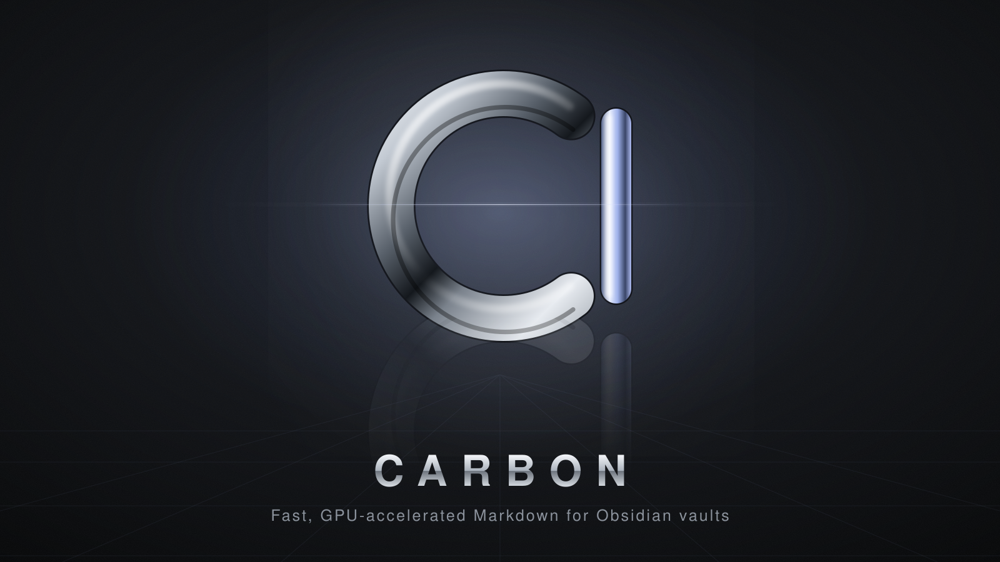

<p align="center">
  
</p>

# Carbon

A fast, GPU-accelerated Markdown editor and viewer for **Obsidian vaults**. Rust, `wgpu`, ~87 MB resident,
zero wake-ups when idle.

Carbon covers the part of Obsidian that is about *opening a vault, browsing it, and reading/writing notes* —
nothing more. No plugins, no graph, no sync.

```
cargo run --release -- /path/to/vault     # or just `carbon` to reopen the last vault
./install.sh                              # installs ~/.local/bin/carbon + desktop entry
```

## Omarchy / Hyprland

* **Theme** – colours come live from `~/.local/state/omarchy/current/theme/colors.toml`.
  Run `omarchy theme set …` and the open editor re-skins instantly (inotify, no polling). Light and dark themes both work.
* **Blur + transparency** – the window surface is transparent and only *background fills* carry opacity
  (`background_opacity`, default `0.82`, same as Foot). Text is always fully opaque, so Hyprland's blur shows
  through without washing out content. Add the rule in `assets/hyprland-carbon.lua` to stop Hyprland's own
  window-wide opacity from dimming the text.
* **Font** – system sans for prose, your `monospace` fontconfig match (Omarchy's font) for code.

## Vaults

* Open any folder as a vault (`.obsidian/` is read, never written).
* Switcher lists recent vaults **and every vault Obsidian knows about** (`~/.config/obsidian/obsidian.json`).
* Tabs/open files/expanded folders are restored per vault (stored in `~/.config/carbon`, not in your vault).
* Watches the vault: edits from git, Obsidian or other editors show up immediately.

## Features

| Area | |
|---|---|
| **Views** | **Live preview** like Obsidian: only the line (or table / properties / code block) the caret is in shows raw Markdown; everything else is rendered in place — headings, bold/italic, links, real bullets, checkboxes you can click, tables, properties panel, rules, callouts, inline images, syntax-highlighted code with hidden fences. Source mode and Reading view are one shortcut away (`Ctrl+E`) |
| **Files** | Tree with folders-first sort, create / rename / delete (to trash) / move by drag-and-drop, context menu |
| **Links** | `[[wikilinks]]`, aliases, `[[note#heading]]`, `![[embeds]]` (images, PDFs, note transclusion), Markdown links; unresolved links create the note on click; renaming/moving rewrites links across the vault |
| **Tabs** | Open, close, reopen (`Ctrl+Shift+T`), pin, drag to reorder, middle-click close, back/forward history per tab |
| **Navigation** | Quick switcher (fuzzy, aliases, create-on-miss), command palette, outline |
| **Search** | Whole-vault, case toggle, `file:` `path:` `tag:` operators, quoted phrases |
| **Panes** | Backlinks, outgoing links, outline, tags |
| **Attachments** | `Ctrl+V` a screenshot → saved to `attachments/` **next to the current note** → `![[Pasted image …png]]` inserted. Dropping files or pasting copied files does the same. Follows `attachmentFolderPath` / `useMarkdownLinks` when the vault sets them |
| **Rendering** | Callouts (foldable), tasks (clickable), tables, code blocks with highlighting, frontmatter properties, `#tags`, `==highlight==`, `%%comments%%`, footnotes, inline images sized with `![[img.png\|300]]` |
| **Editing** | List/task/quote continuation, `Tab`/`Shift+Tab` indent, bracket auto-pair, wrap selection (`**`, `*`, `==`…), paste URL over selection → link, `[[` autocomplete, find & replace, auto-save, word/char count |

## Shortcuts

`Ctrl+O` switcher · `Ctrl+P` palette · `Ctrl+N` new note · `Ctrl+T` new tab · `Ctrl+W` close · `Ctrl+Shift+T` reopen ·
`Ctrl+Tab` / `Ctrl+Shift+Tab` cycle · `Alt+1…9` jump to tab · `Alt+←/→` back/forward · `Ctrl+E` reading ⇄ editing ·
`Ctrl+F` find · `Ctrl+H` replace · `Ctrl+Shift+F` vault search · `Ctrl+\` collapse/show the file browser · `Ctrl+Shift+\` right sidebar ·
`Ctrl+B/I` bold/italic · `Ctrl+K` link · `Ctrl+1…3` headings · `Ctrl+Shift+8/7/9` bullet/number/task list ·
`Ctrl+Shift+V` switch vault · `Ctrl+,` settings · `F2` rename · `Ctrl+=/-/0` zoom.
`Ctrl`+click follows a link in a new tab; in Live preview a plain click on a rendered link follows it.
Everything is also in the palette.

## GPU cursor shaders

The caret is a full-viewport WGSL fragment shader. The CPU only animates four trail corners (Neovide-style)
and uploads one uniform buffer per frame. Built-in effects: `trail`, `glow`, `pulse`, `plain`.

Pick `custom` in Settings (or run *Edit custom cursor shader*) to edit `~/.config/carbon/cursor.wgsl`.
It **hot-reloads on save**; a shader error keeps the previous pipeline and is shown in the status bar.
You write one function:

```wgsl
fn cursor_fx(p: vec2<f32>) -> vec4<f32> {   // p = point in the editor viewport, in points
    let d = sd_trail(p);                      // signed distance to the animated trail quad
    let a = smoothstep(0.5, -0.5, d) * fx.state.x;   // fx.state.x = blink (0/1)
    return vec4(fx.color.rgb * a, a);         // premultiplied RGBA
}
```

Available: `fx.rect` (real caret x,y,w,h) · `fx.color` · `fx.view` (w, h, time, seconds-since-move) ·
`fx.state` (blink, shape, scale, travel) · `fx.c01`/`fx.c23` (trail corners) · `sd_cursor(p)` · `sd_trail(p)`.
Tick **Animate every frame** in Settings if your shader uses `fx.view.z` (time) and should keep moving at rest.
See `src/shaders/prelude.wgsl` for the full contract.

## Config

`~/.config/carbon/config.json` (hot-reloaded) — theme opacity, font size, default view, cursor effect/shape/blink/colour,
auto-save delay, readable line length. Settings UI edits the same file.

## Development

```
cargo test          # parsing, link resolution, rename rewriting, editing commands, WGSL validation of every preset
CARBON_FPS=1 cargo run   # print frames/2 s to verify idle wake-ups
CARBON_OMARCHY_DIR=/tmp/fake-theme-dir cargo run   # point the theme watcher somewhere else
```

Layout: `vault.rs` (index, links, attachments, rename) · `editor.rs` (Live/Source styling, edit commands) ·
`reader.rs` (reading view) · `cursor_fx.rs` + `shaders/` (GPU caret) · `theme.rs` + `hot.rs` (Omarchy theme, hot reload) ·
`ui*.rs` (egui front end).
